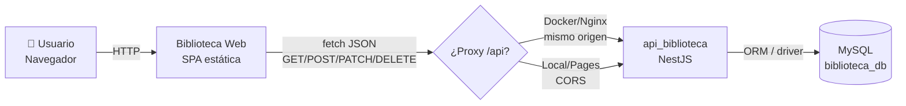
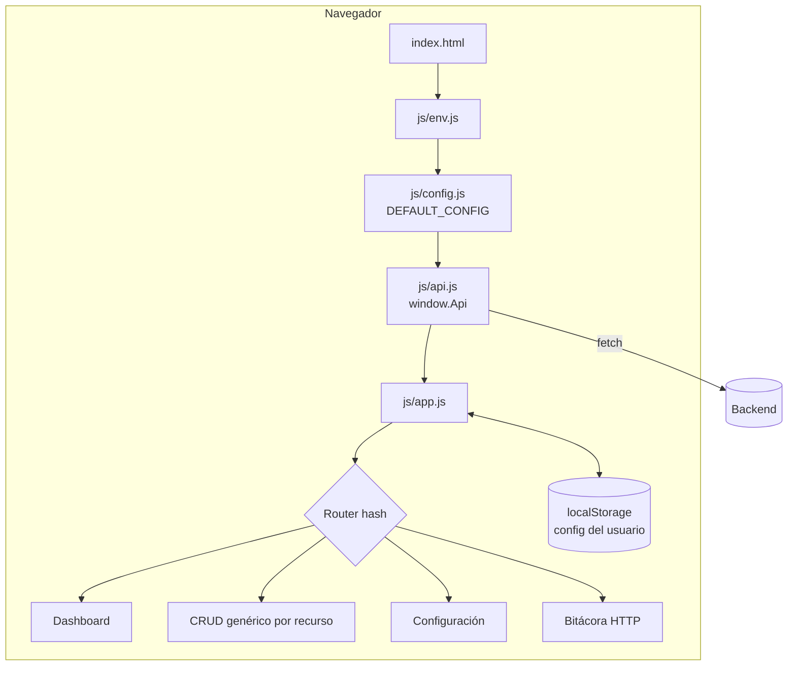
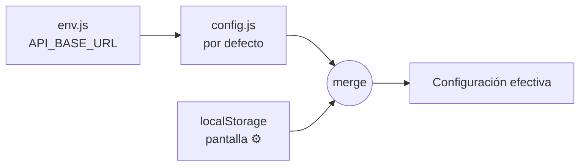
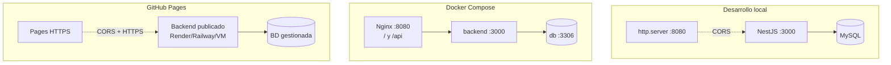

# Arquitectura

## 1. Vista general

Tres capas desacopladas:

| Capa | Tecnología | Responsabilidad |
|---|---|---|
| Presentación | HTML/CSS/JS puro (este repo) | UI, validación básica, configuración, bitácora |
| Servicios | `api_biblioteca` (NestJS, supuesto) | Reglas de negocio, validación (DTO), persistencia |
| Datos | MySQL (supuesto, script `.sql`) | Tablas libros, autores, categorías, usuarios, préstamos |

## 2. Componentes del frontend

| Archivo | Responsabilidad | Puntos clave |
|---|---|---|
| `env.js` | Variables inyectadas en runtime | Lo reescribe `docker/40-env.sh` o el workflow de Pages |
| `config.js` | Valores por defecto versionados | Recursos, `idField`, `updateMethod`, timeout |
| `api.js` | Cliente HTTP | `AbortController` (timeout), normaliza listas, interpreta errores NestJS `{statusCode,message,error}`, registra bitácora |
| `app.js` | Lógica de UI | Router `#/…`, inferencia de campos, formularios, ordenamiento/filtro en cliente, render seguro con `textContent` |

## 3. Modelo de configuración

## 4. Inferencia de campos

Si un recurso tiene `fields: []`, al recibir la lista se toma el primer registro y se deduce el tipo de cada propiedad:

| Valor recibido | Tipo inferido | Control en el formulario |
|---|---|---|
| `12`, `3.5` | number | `<input type="number">` |
| `true` / `false` | boolean | checkbox |
| `"2026-11-24"` / ISO | date | `<input type="date">` |
| `"a@b.com"` | email | `<input type="email">` |
| objeto / array (relaciones) | json | textarea JSON |
| otro texto | text | `<input type="text">` |

Limitación: con la tabla vacía no hay qué inferir → se usa el **modo JSON** o se declaran `fields` explícitos.

## 5. Topologías de despliegue

## 6. Decisiones de diseño

| Decisión | Motivo |
|---|---|
| Sin framework ni build | Despliegue directo en Pages/Nginx, cero dependencias que parchear, fácil de auditar |
| CRUD genérico dirigido por configuración | El esquema real del backend no estaba disponible; se adapta sin reescribir código |
| Proxy `/api` en Nginx | Elimina CORS y oculta el puerto del backend |
| `textContent` en todo render | Datos de BD pueden contener HTML/JS: previene XSS almacenado |
| Bitácora en memoria | Diagnóstico sin persistir datos ni tokens |
