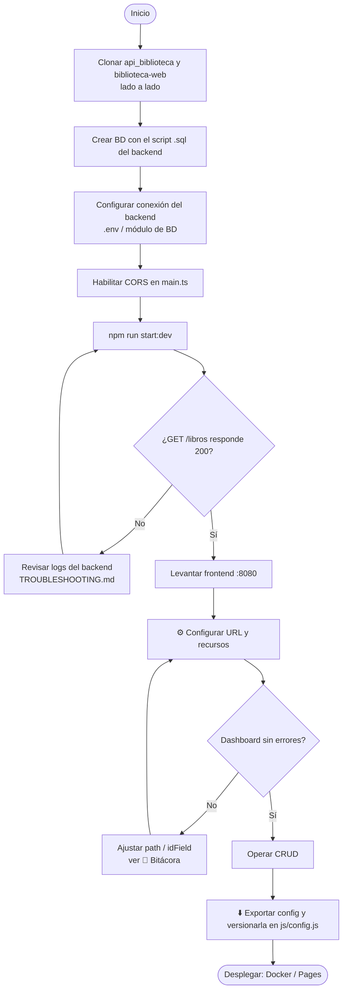
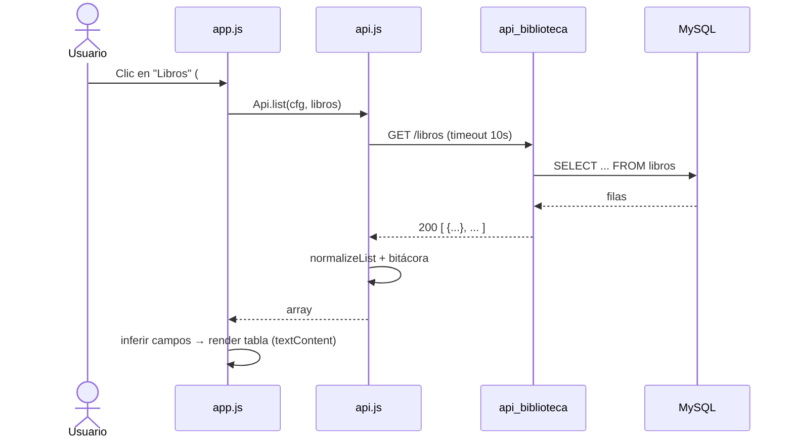
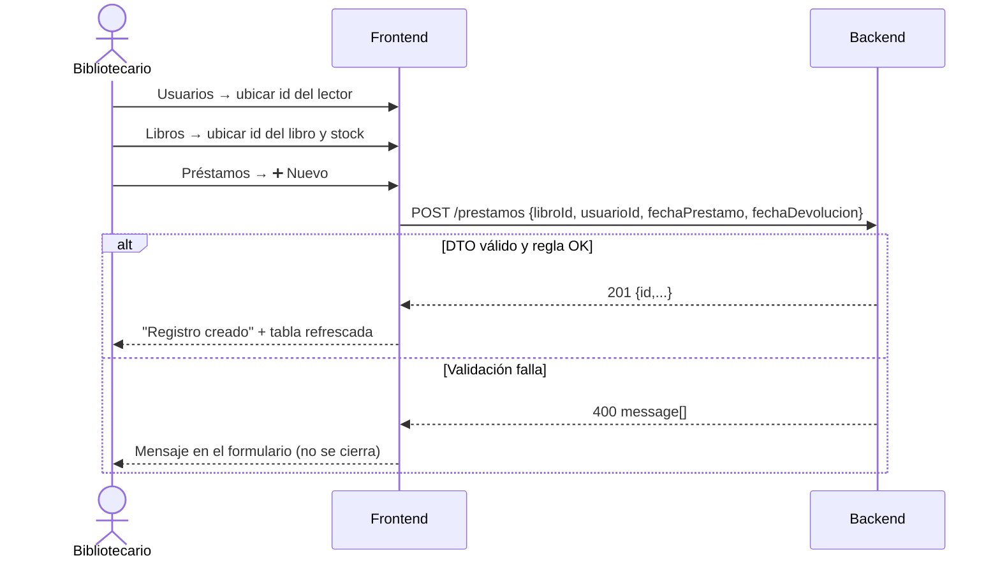
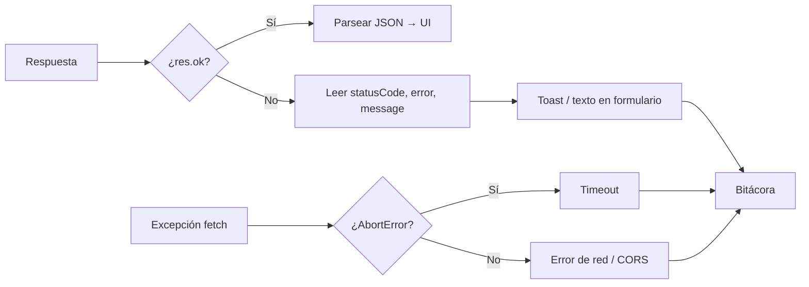
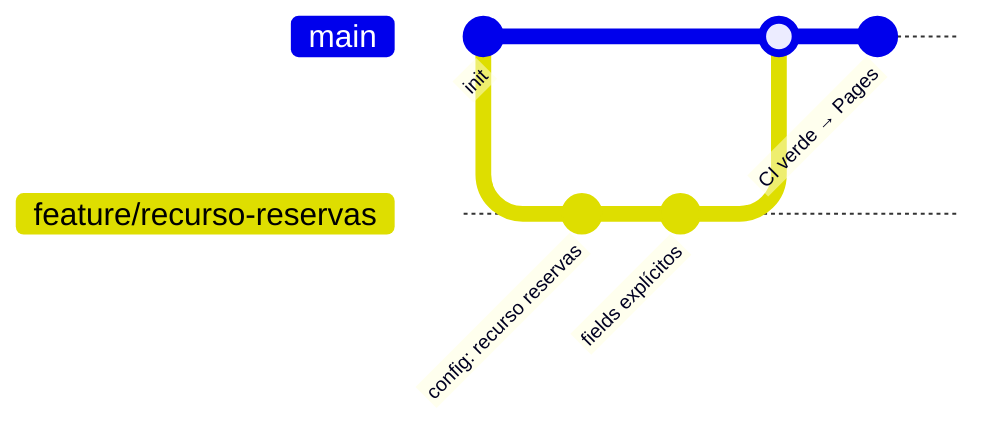

# Flujo de trabajo

## 1. Flujo general (de cero a operando)



## 2. Paso a paso detallado

### Paso 1 — Preparar carpetas

```bash
mkdir biblioteca && cd biblioteca
git clone https://github.com/MarbelVega/api_biblioteca
# descomprimir biblioteca-web.zip aquí
```

### Paso 2 — Base de datos

```bash
# MySQL local (o el contenedor 'db' del compose)
mysql -u root -p < api_biblioteca/biblioteca_db.sql
mysql -u root -p -e "SHOW TABLES;" biblioteca_db
```

Anota los **nombres de tablas y columnas**: te dirán qué recursos y qué `idField` configurar.

### Paso 3 — Backend

```bash
cd api_biblioteca
npm install
npm run start:dev
curl -i http://localhost:3000/libros
```

Para listar las rutas reales que expone NestJS, revisa los controladores:

```bash
grep -rn "@Controller\|@Get\|@Post\|@Patch\|@Put\|@Delete" src/
```

Cada `@Controller('xxx')` es un recurso → `path: "/xxx"`. Si existe `app.setGlobalPrefix('api')` en `main.ts`, la URL base es `http://localhost:3000/api`.

### Paso 4 — Frontend

```bash
cd ../biblioteca-web
python3 -m http.server 8080
```

### Paso 5 — Configurar

En **⚙️ Configuración**:

1. URL base → `http://localhost:3000` (o `/api` si hay prefijo global).
2. Método de actualización → `PATCH` si ves `@Patch(':id')`, `PUT` si ves `@Put(':id')`.
3. Recursos → un objeto por controlador; `idField` = nombre de la PK (`id`, `id_libro`, `idLibro`…).
4. 💾 Guardar → 🔌 Probar conexión.

### Paso 6 — Validar

- Dashboard: cada tarjeta debe mostrar un número.
- Una tarjeta con `404 Not Found Cannot GET /xxx` = ruta mal escrita.
- `Error de red / CORS` = backend caído o CORS no habilitado.

### Paso 7 — Operar

| Acción | Cómo | Llamada HTTP |
|---|---|---|
| Listar | Abrir el recurso en el menú | `GET /recurso` |
| Filtrar | Caja "Filtrar…" (busca en todo el registro) | — (cliente) |
| Ordenar | Clic en la cabecera de columna | — (cliente) |
| Crear | ➕ Nuevo → completar → Guardar | `POST /recurso` |
| Editar | ✏️ → modificar → Guardar | `PATCH|PUT /recurso/:id` |
| Eliminar | 🗑️ → confirmar | `DELETE /recurso/:id` |
| Relaciones | Escribir el id foráneo (`autorId`) o usar modo JSON con el objeto | según DTO |

### Paso 8 — Versionar configuración

⬇️ Exportar → copiar `resources` y demás valores a `js/config.js` → commit. Así todos los usuarios y despliegues parten de la misma configuración.

## 3. Secuencias por operación

### Carga de un recurso



### Crear un préstamo (ejemplo de flujo de negocio)



### Manejo de errores



## 4. Flujo de desarrollo (Git)



1. Rama `feature/*` por cambio.
2. `node --check js/*.js` y smoke test local contra el mock.
3. Pull Request → `ci.yml` (sintaxis, smoke test, build Docker).
4. Merge a `main` → `pages.yml` publica en GitHub Pages.

## 5. Agregar un recurso nuevo (ej. `reservas`)

1. Backend: `nest g resource reservas` (o crear controlador/servicio/entidad).
2. Frontend: añadir en ⚙️ o `config.js`:
   ```json
   { "key": "reservas", "label": "Reservas", "icon": "📅", "path": "/reservas", "idField": "id", "fields": [] }
   ```
3. Validar en Dashboard. No hay que tocar `app.js`.
